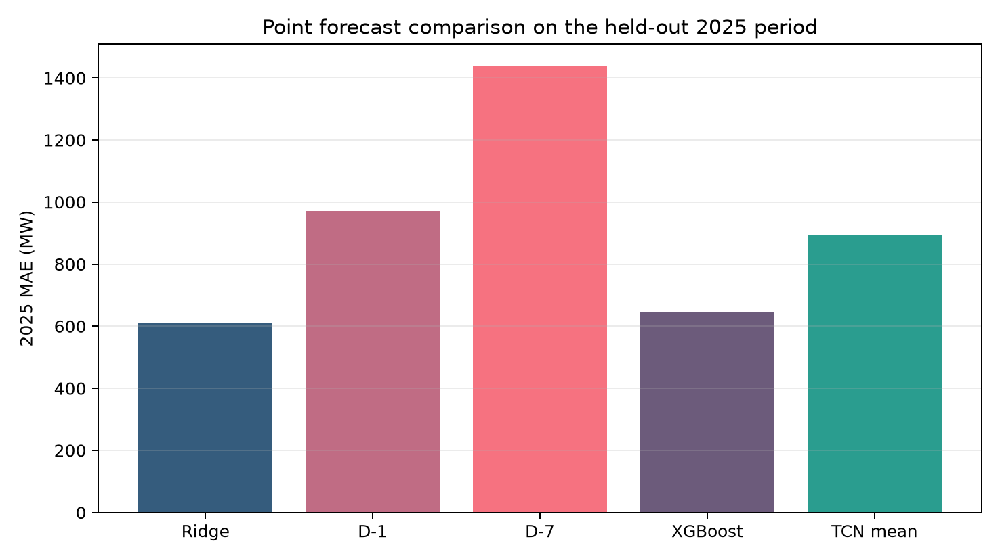
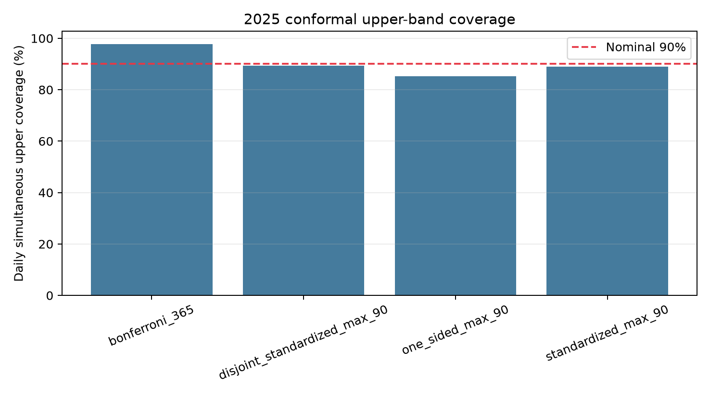
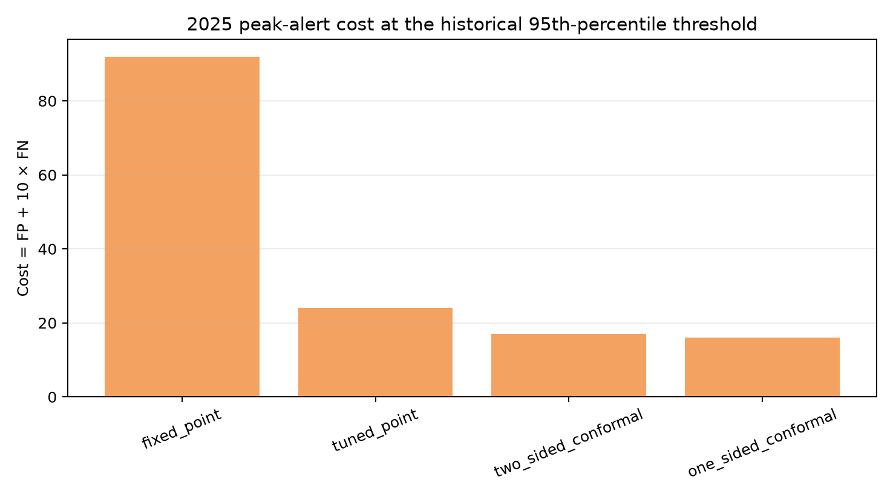

# ISO_NE_REVISION_V1.0 全套大修实验报告

## 执行结论

整套 E2–E19 已执行完成。ISO-NE 的 OOS 残差与时间边界硬门禁状态为 **PASS**；冻结输入的 5 项哈希/结构检查全部通过。2025 始终作为最终评估期，2024 仅用于决策参数选择；测试期没有用于超参数或阈值选择。

本报告中的 coverage 是滚动、依赖数据下的经验覆盖率，不表述为交换性条件下的严格有限样本保证。Equal-alert comparator 明确标记为 ex-post 诊断，不作为可部署规则。

## 1. 2025 点预测结果

| 模型 | MAE (MW) | RMSE (MW) | MAPE (%) | 峰值 MAE (MW) |
| --- | --- | --- | --- | --- |
| Ridge | 611.656 | 945.908 | 4.458 | 721.494 |
| D-1 | 970.681 | 1404.333 | 7.115 | 961.496 |
| D-7 | 1436.523 | 2075.543 | 10.327 | 1532.145 |
| XGBoost | 644.491 | 984.869 | 4.657 | 761.658 |
| TCN seeds (mean ± SD) | 894.12 ± 38.03 | 1255.50 ± 46.36 | 6.488 ± 0.274 | 983.98 ± 40.18 |
| TCN five-seed ensemble | 876.150 | 1234.982 | 6.354 | 967.332 |

XGBoost 的候选模型只依据 2020–2023 rolling-origin MAE 选择；入选配置为 **balanced**。TCN 使用固定架构和 seeds = 11, 22, 33, 42, 55；所有无法追溯的旧版 ‘original TCN prediction path’ 均不再使用。

下表给出 2025 日级误差的 paired moving-block bootstrap（7-day block，5,000 次）。差值定义为 comparator − Ridge，正值表示 Ridge 的误差更低。每个 TCN seed 的结果及 block=3/14/28 天敏感性均保存在完整 CSV。

| Comparator | Reference | MAE 差值 (MW) | 95% CI 下限 | 95% CI 上限 | P(差值>0) |
| --- | --- | --- | --- | --- | --- |
| D-1 | Ridge | 359.025 | 287.794 | 435.264 | 1.000 |
| D-7 | Ridge | 824.867 | 629.819 | 1045.986 | 1.000 |
| XGBoost balanced | Ridge | 32.835 | 8.399 | 61.040 | 0.996 |
| TCN five-seed ensemble | Ridge | 264.494 | 198.000 | 337.463 | 1.000 |

## 2. 2025 Conformal 区间/上界

| 方法 | 逐日联合上界覆盖率 (%) | 逐小时上界覆盖率 (%) | 峰值小时上界覆盖率 (%) | 平均上边际 (MW) | 双侧逐日联合覆盖率 (%) | 平均宽度 (MW) |
| --- | --- | --- | --- | --- | --- | --- |
| bonferroni_365 | 97.808 | 99.760 | 100.000 | 3545.272 | 96.986 | 7090.543 |
| disjoint_standardized_max_90 | 89.315 | 98.048 | 97.534 | 2771.753 | 84.932 | 5543.506 |
| one_sided_max_90 | 85.205 | 97.306 | 96.712 | 2130.807 | NA | NA |
| standardized_max_90 | 89.041 | 98.276 | 98.082 | 2471.865 | 84.932 | 4943.730 |

方法口径：M1 为 90-day standardized-max；M2 为 365-day corrected Bonferroni；M3 为 one-sided standardized-max；M4 用 d-180:d-91 估计尺度、d-90:d-1 校准 score。所有 q、尺度和 score 均只引用目标日前已经产生的 OOS 残差。

## 3. 2025 峰值预警主比较（历史 95% 阈值，漏报代价比 10）

| 规则 | 调参类型 | 参数 | TP | FP | FN | TN | 预警数 | Precision | Recall | FAR | Cost | Ex-post |
| --- | --- | --- | --- | --- | --- | --- | --- | --- | --- | --- | --- | --- |
| fixed_point | none | 0.000 | 8 | 2 | 9 | 346 | 10 | 0.800 | 0.471 | 0.006 | 92.000 | False |
| tuned_point | delta_mw | 2350.000 | 16 | 14 | 1 | 334 | 30 | 0.533 | 0.941 | 0.040 | 24.000 | False |
| two_sided_conformal | lambda | 0.700 | 17 | 17 | 0 | 331 | 34 | 0.500 | 1.000 | 0.049 | 17.000 | False |
| equal_alert_point_two_sided | test_alert_count | 34.000 | 17 | 17 | 0 | 331 | 34 | 0.500 | 1.000 | 0.049 | 17.000 | True |
| one_sided_conformal | lambda | 0.700 | 17 | 16 | 0 | 332 | 33 | 0.515 | 1.000 | 0.046 | 16.000 | False |
| equal_alert_point_one_sided | test_alert_count | 33.000 | 16 | 17 | 1 | 331 | 33 | 0.485 | 0.941 | 0.049 | 27.000 | True |

主 paired moving-block bootstrap（7-day block，5,000 次）对 Cost 差值的结果如下；差值定义为 conformal − tuned point，负值表示 conformal 成本更低。

| 方法 A | 方法 B | 观察差值 | 95% CI 下限 | 95% CI 上限 | P(差值<0) |
| --- | --- | --- | --- | --- | --- |
| two_sided_conformal | tuned_point | -7.000 | -28.000 | 6.000 | 0.653 |
| one_sided_conformal | tuned_point | -8.000 | -29.000 | 4.000 | 0.679 |

完整的 5 个阈值口径 × 5 个成本比 × 所有主要规则位于 decision cube；block=3/7/14/28 天的配对不确定性位于 bootstrap 表。

## 4. 多年份与 λ 稳定性

2020–2024 只解释为 retrospective rolling-origin diagnostics，不包装成新的独立测试集；2025 是主测试期，2026H1 是追加的时间外诊断。

| 年份 | 上界类型 | 成本比 | λ | Cost | Recall | FAR |
| --- | --- | --- | --- | --- | --- | --- |
| 2020 | two_sided | 1.000 | 0.000 | 6.000 | 0.615 | 0.003 |
| 2020 | two_sided | 2.000 | 0.100 | 10.000 | 0.769 | 0.011 |
| 2020 | two_sided | 5.000 | 0.400 | 16.000 | 0.923 | 0.031 |
| 2020 | two_sided | 10.000 | 0.400 | 21.000 | 0.923 | 0.031 |
| 2020 | two_sided | 20.000 | 0.700 | 23.000 | 1.000 | 0.065 |
| 2020 | one_sided | 1.000 | 0.000 | 6.000 | 0.615 | 0.003 |
| 2020 | one_sided | 2.000 | 0.100 | 10.000 | 0.769 | 0.011 |
| 2020 | one_sided | 5.000 | 0.500 | 16.000 | 0.923 | 0.031 |
| 2020 | one_sided | 10.000 | 0.800 | 20.000 | 1.000 | 0.057 |
| 2020 | one_sided | 20.000 | 0.800 | 20.000 | 1.000 | 0.057 |
| 2021 | two_sided | 1.000 | 0.100 | 9.000 | 0.529 | 0.003 |
| 2021 | two_sided | 2.000 | 0.400 | 17.000 | 0.706 | 0.020 |
| 2021 | two_sided | 5.000 | 0.700 | 24.000 | 0.941 | 0.055 |
| 2021 | two_sided | 10.000 | 0.800 | 29.000 | 1.000 | 0.083 |
| 2021 | two_sided | 20.000 | 0.800 | 29.000 | 1.000 | 0.083 |
| 2021 | one_sided | 1.000 | 0.100 | 9.000 | 0.529 | 0.003 |
| 2021 | one_sided | 2.000 | 0.500 | 15.000 | 0.765 | 0.020 |
| 2021 | one_sided | 5.000 | 0.800 | 22.000 | 0.941 | 0.049 |
| 2021 | one_sided | 10.000 | 0.900 | 26.000 | 1.000 | 0.075 |
| 2021 | one_sided | 20.000 | 0.900 | 26.000 | 1.000 | 0.075 |
| 2022 | two_sided | 1.000 | 0.200 | 8.000 | 0.765 | 0.011 |
| 2022 | two_sided | 2.000 | 0.200 | 12.000 | 0.765 | 0.011 |
| 2022 | two_sided | 5.000 | 0.500 | 18.000 | 0.941 | 0.037 |
| 2022 | two_sided | 10.000 | 0.600 | 20.000 | 1.000 | 0.057 |
| 2022 | two_sided | 20.000 | 0.600 | 20.000 | 1.000 | 0.057 |
| 2022 | one_sided | 1.000 | 0.100 | 8.000 | 0.706 | 0.009 |
| 2022 | one_sided | 2.000 | 0.500 | 13.000 | 0.882 | 0.026 |
| 2022 | one_sided | 5.000 | 0.700 | 18.000 | 1.000 | 0.052 |
| 2022 | one_sided | 10.000 | 0.700 | 18.000 | 1.000 | 0.052 |
| 2022 | one_sided | 20.000 | 0.700 | 18.000 | 1.000 | 0.052 |
| 2023 | two_sided | 1.000 | 0.200 | 7.000 | 0.375 | 0.006 |
| 2023 | two_sided | 2.000 | 0.200 | 12.000 | 0.375 | 0.006 |
| 2023 | two_sided | 5.000 | 1.000 | 19.000 | 1.000 | 0.053 |
| 2023 | two_sided | 10.000 | 1.000 | 19.000 | 1.000 | 0.053 |
| 2023 | two_sided | 20.000 | 1.000 | 19.000 | 1.000 | 0.053 |
| 2023 | one_sided | 1.000 | 0.200 | 7.000 | 0.375 | 0.006 |
| 2023 | one_sided | 2.000 | 0.200 | 12.000 | 0.375 | 0.006 |
| 2023 | one_sided | 5.000 | 0.800 | 24.000 | 0.750 | 0.039 |
| 2023 | one_sided | 10.000 | 0.800 | 34.000 | 0.750 | 0.039 |
| 2023 | one_sided | 20.000 | 0.800 | 54.000 | 0.750 | 0.039 |
| 2024 | two_sided | 1.000 | 0.100 | 9.000 | 0.600 | 0.009 |
| 2024 | two_sided | 2.000 | 0.100 | 15.000 | 0.600 | 0.009 |
| 2024 | two_sided | 5.000 | 0.700 | 25.000 | 0.933 | 0.057 |
| 2024 | two_sided | 10.000 | 0.700 | 30.000 | 0.933 | 0.057 |
| 2024 | two_sided | 20.000 | 0.700 | 40.000 | 0.933 | 0.057 |
| 2024 | one_sided | 1.000 | 0.100 | 9.000 | 0.600 | 0.009 |
| 2024 | one_sided | 2.000 | 0.100 | 15.000 | 0.600 | 0.009 |
| 2024 | one_sided | 5.000 | 0.700 | 24.000 | 0.933 | 0.054 |
| 2024 | one_sided | 10.000 | 0.700 | 29.000 | 0.933 | 0.054 |
| 2024 | one_sided | 20.000 | 0.700 | 39.000 | 0.933 | 0.054 |

## 5. NYISO 外部验证

NYISO 沿用 ISO-NE 冻结后的 233 维特征逻辑、Ridge α=100、5 年滚动训练、calibration windows、决策网格和 bootstrap 方法。NYISO 的 2024 年只用于调参，2025 年用于 external evaluation。原始归档在 2021-04-01 至 2021-06-02 有早期缺口，但 2023–2025 OOS 以及 2024–2025 校准/评估日期连续，并已通过独立门禁。

| 模型 | 天数 | MAE (MW) | RMSE (MW) | MAPE (%) | 峰值 MAE (MW) |
| --- | --- | --- | --- | --- | --- |
| Ridge | 365 | 610.657 | 938.180 | 3.492 | 719.261 |
| D-1 | 365 | 1004.465 | 1440.346 | 5.745 | 984.353 |
| D-7 | 365 | 1552.844 | 2242.295 | 8.679 | 1602.634 |

| 方法 | 逐日联合上界覆盖率 (%) | 逐小时上界覆盖率 (%) | 峰值小时覆盖率 (%) | 平均上边际 (MW) |
| --- | --- | --- | --- | --- |
| bonferroni_365 | 98.904 | 99.817 | 100.000 | 3741.463 |
| disjoint_standardized_max_90 | 92.603 | 98.870 | 98.356 | 2574.034 |
| one_sided_max_90 | 89.589 | 97.797 | 96.438 | 1783.268 |
| standardized_max_90 | 92.329 | 98.550 | 97.808 | 2183.486 |

## 6. 可复现性与文件索引

- `00_freeze/`: 冻结配置、输入哈希和 E1.1 接受记录。
- `A_oos_and_audit/`: E2 OOS forecast store、逐月模型审计、E3 门禁。
- `B_conformal/`: E4–E7 四种 conformal 方法的逐日完整输出和年度指标。
- `C_decision_and_bootstrap/`: E8–E10、E14–E15 的调参、逐日决策、decision cube 和 paired bootstrap。
- `D_baselines/`: E11 D-1/D-7、E12 XGBoost、E13 五 seed TCN。
- `E_sensitivity/`: E16 λ 稳定性和 E17 多年份结果。
- `F_nyiso_external/`: E18 NYISO 全套外部验证。
- `G_reproducibility/`: E19 硬件、软件、运行时间、状态和全部文件 SHA-256。

具体论文取舍应以 bootstrap CI、跨年份稳定性和 NYISO 方向一致性共同判断，不能只凭单个 2025 点估计下结论。
